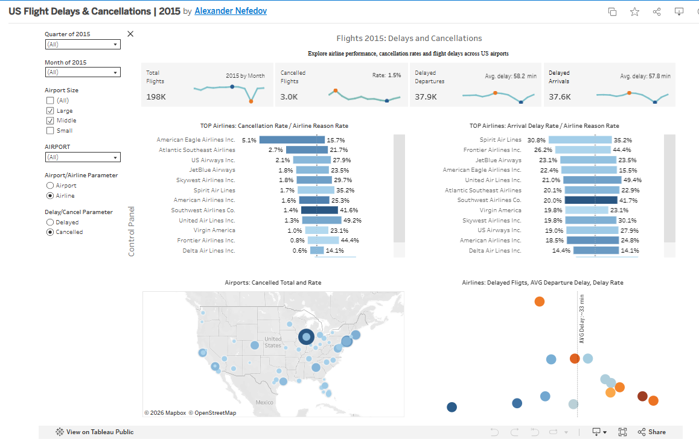

# US Flight Delays & Cancellations | 2015

### Interactive Tableau Dashboard | Data Analytics Portfolio Project

**[Explore the Interactive Dashboard on Tableau Public](https://public.tableau.com/app/profile/alexander.nefedov/viz/USFlightDelaysCancellations2015/DashboardMain)**

## Dashboard Preview

## Project Overview

This project explores flight delays, cancellations, and airline performance across US airports using 2015 flight data.

The goal is to turn flight operations data into an interactive dashboard that helps users identify patterns, compare airlines and airports, and investigate potential operational issues.

## Tools & Skills

- **Tableau Public** — interactive dashboard development
- **Calculated Fields** — operational metrics and rates
- **Data Visualization** — KPI cards, time trends, bar charts, geographical maps, and scatter plots
- **Interactive Analysis** — filters, parameters, and detailed tooltips

## Dashboard Features

**Key Performance Indicators**
- Total flights
- Cancelled flights and cancellation rate
- Delayed departures and average departure delay
- Delayed arrivals and average arrival delay

**Airline & Airport Comparisons**

Compare cancellation rates, arrival delays, and reasons for operational disruptions across airlines and airports.

**Geographical Analysis**

Explore the geographical distribution of flight cancellations and delays across US airports.

**Airline Performance Scatter Plot**

Compare airlines using average departure delay, delayed flight volume, and delay rates.

**Interactive Exploration**

Filter results by month, quarter, airport size, and selected airport or airline. Switch between available comparison views.

## Live Dashboard

[Open US Flight Delays & Cancellations | 2015](https://public.tableau.com/app/profile/alexander.nefedov/viz/USFlightDelaysCancellations2015/DashboardMain)

## Project Status

The interactive dashboard is published on Tableau Public. Additional documentation, data-source details, and analytical findings are being prepared.
